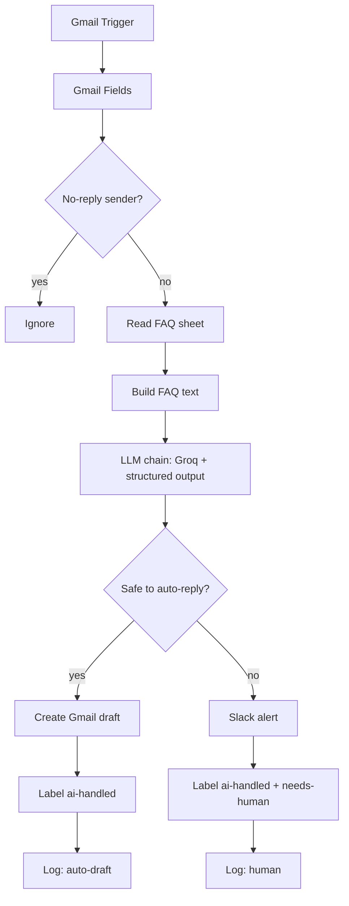

# AI Support Auto-Replier (n8n)

An n8n workflow that reads new support emails in Gmail, answers them from a company FAQ using an LLM (Groq), and sends anything it is not sure about to a human in Slack.

By default it saves replies as **Gmail drafts**, so nothing is sent to a customer until you decide to switch it on.


## Demo

A short walkthrough of the workflow running on real emails:

[Watch the demo video](docs/demo.mp4)

<!-- While editing this file on GitHub, drag demo.mp4 onto the empty line below. GitHub inserts the video link there and shows a player. -->


## What it does

1. **Gmail Trigger** checks the inbox every minute for new unread emails.
2. **No-reply filter** skips automated senders (`noreply`, `no-reply`).
3. The **FAQ** is read from a Google Sheet and turned into one block of text.
4. An **LLM chain** (Groq) reads the email and the FAQ and returns structured JSON.
5. A **safety check** decides if the reply is safe to prepare automatically.
6. **Safe:** a Gmail draft is created in the customer's thread.
   **Not safe:** a Slack alert goes to a human with the email details and the suggested draft.
7. The email gets a Gmail label so it is never processed twice.
8. Every decision is written to a **Support Log** Google Sheet.
9. A separate **error workflow** posts to Slack if anything fails.



## The decision rule

The LLM returns this JSON for every email:

```json
{
  "can_answer": true,
  "needs_human": false,
  "category": "Shipping",
  "confidence": 0.95,
  "reply": "Standard shipping takes 5-7 business days."
}
```

The `safe to auto-reply` node sends the email down the draft path only when **all three** conditions are true:

| Condition | Why |
|---|---|
| `can_answer` is `true` | The FAQ clearly answers the question |
| `needs_human` is `false` | Not a refund, legal threat, angry customer or security issue |
| `confidence >= 0.8` | The model is sure the FAQ fully answers it |

Anything else goes to Slack. The confidence number is never trusted on its own, because a model can be very sure that it cannot answer.

## Safety design

- **FAQ only.** The prompt forbids inventing prices, policies, dates or promises.
- **Empty reply when unsure.** If `can_answer` is `false`, the reply must be empty and Slack shows "No draft".
- **Fixed categories.** `Shipping, Returns, Account, Pricing, Billing, Support, Other`.
- **Draft mode first.** A human can read every draft before anything is sent.
- **No reply loops.** The trigger ignores your own emails (`-from:me`) and already handled emails (`-label:ai-handled`), and no-reply senders are skipped.
- **Audit log.** Every decision is stored with time, sender, subject, category, confidence and decision.
- **Error alerts.** A second workflow reports failed runs in Slack.

## Repository structure

```
support-auto-replier/
├── README.md
├── workflow/
│   ├── support-auto-replier.json   # main workflow
│   └── error-alert.json            # error workflow
├── data/
│   └── faq-sample.csv              # sample FAQ to import into Google Sheets
└── docs/
    ├── canvas.png                  # screenshot of the workflow
    ├── demo.mp4                    # demo video
    └── demo-script.md              # script for the demo video
```

## Setup

### 1. What you need

- n8n (self-hosted with Docker, or n8n Cloud)
- A Google account (Gmail and Google Sheets)
- A Slack workspace
- A Groq API key

### 2. Google Sheets

Create two spreadsheets:

- **FAQ:** import `data/faq-sample.csv`. The headers must be exactly `ID`, `Category`, `Question`, `Answer`.
- **Support Log:** an empty sheet with these headers in row 1: `time`, `from`, `subject`, `category`, `confidence`, `decision`.

### 3. Gmail labels

In Gmail, create two labels: `ai-handled` and `needs-human`.

### 4. Credentials in n8n

| Credential | How |
|---|---|
| **Gmail OAuth2** and **Google Sheets OAuth2** | In Google Cloud Console, create a project, enable the Gmail API and Google Sheets API, create an OAuth client (Web application), add your Gmail address as a test user, and add the redirect URL shown in n8n (for local n8n: `http://localhost:5678/rest/oauth2-credential/callback`) |
| **Groq API** | Create an API key at console.groq.com |
| **Slack API** | Create a Slack app (From scratch), add the bot scopes `chat:write`, `chat:write.public` and `channels:read`, install it to your workspace, and use the `xoxb-` Bot User OAuth Token with **Authentication: Access Token** |

Do not enable token rotation in the Slack app. A rotating token expires and the access-token method cannot refresh it.

### 5. Import the workflow

1. In n8n, open the workflow menu and choose **Import from file**. Import `workflow/support-auto-replier.json`.
2. Fix the placeholders and credentials:

| Node | What to set |
|---|---|
| Gmail Trigger, Create a draft, both label nodes | Gmail credential |
| Get row(s) in sheet | Google Sheets credential, your FAQ spreadsheet |
| Both Append row nodes | Google Sheets credential, your Support Log spreadsheet |
| Groq Chat Model | Groq credential |
| Send a message | Slack credential, your channel |
| Both label nodes | Pick the `ai-handled` label (and `needs-human` on the Slack branch) from the dropdown |

### 6. Import the error workflow

1. Import `workflow/error-alert.json`, set the Slack credential and channel, and save it.
2. In the main workflow, open **Settings** and set **Error Workflow** to `Support Error Alert`.

### 7. Test, then publish

1. Click **Execute workflow** with a real unread email in your inbox.
2. When both paths work, click **Publish**.
3. While testing, you can limit the trigger to one label by adding `label:support-test` to the Gmail Trigger search.

## Test emails

Send these from a second email address:

| Email | Expected result |
|---|---|
| "How long does express shipping take and how much is it?" | Gmail draft with 2-3 business days and $14.99, log row `auto-draft` |
| "I want a refund, this is a scam!" | Slack alert, log row `human` |
| "Can you give me a 40% discount?" (not in the FAQ) | Slack alert with "No draft" |
| An email from a `noreply@` address | Ignored |

## Switching from drafts to real replies

After you have reviewed drafts for a while and trust the answers, replace **Create a draft** with **Gmail → Reply to a message**:

- **Message ID:** `{{ $('Gmail Fields').item.json.message_id }}`
- **Email Type:** Text
- **Message:** `{{ $json.output.reply }}`

## Limitations

- The whole FAQ is placed in the prompt. This works for small FAQs (tens of questions). For hundreds of documents, use a vector store (RAG) instead.
- The trigger polls once per minute, so replies are not instant.
- The workflow uses the email `text` field and falls back to the short Gmail `snippet`, so very long emails may be only partly read.
- The model's `confidence` is a self-reported number. Treat it as a signal, not a measurement.

## Roadmap

- Approve or reject drafts with buttons in Slack (Slack **Send and wait for response**)
- Replace the Google Sheet FAQ with a vector store (RAG)
- A test set of sample emails with expected outcomes, and an accuracy report
- A small React dashboard for auto-draft rate, escalations and categories from the Support Log

## Tech stack

n8n, Gmail API, Google Sheets, Groq (`openai/gpt-oss-120b`), Slack API.
